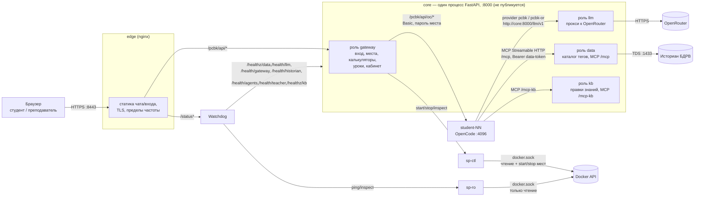

# Архитектура

## Назначение

`pcbk-reserve` — учебный стенд для технологов: веб-чат, в котором студент говорит с агентом-помощником и
может собрать свои агенты, а числа процесса агент берёт не у модели, а у кода — через службу данных,
обращающуюся к историану реального времени. Движок диалога — [OpenCode](https://github.com/anomalyco/opencode)
в изолированном контейнере на каждое место, модели — через OpenRouter за собственным прокси с учётом
расходов. Один серверный процесс (`core`) несёт несколько ролей: доступ к историану и MCP-инструменты,
прокси к LLM с бюджетом, вход и управление рабочими местами, правки базы знаний и (опционально) аналитику
корпуса КДМ-1. Вход снаружи — один TLS-прокси (`edge`); состояние стенда снимает отдельный сторож
(`watchdog`), работающий в обход серверного слоя. Единственная точка выхода во внешние сети (историан,
OpenRouter) — сам `core`, и только из одного контейнера.

Стенд рассчитан на изоляцию по месту: у каждого студента — свой контейнер OpenCode в своей сети, без
доступа к соседям и без прямого доступа в интернет или к Docker. Остановку и запуск контейнеров мест ведут
два экземпляра `wollomatic/socket-proxy` (прокси сокета Docker) с узким списком разрешённых операций — ни
`core`, ни `watchdog` не держат настоящий `docker.sock`.

## Схема компонентов

## Контейнеры docker compose

Один файл `compose.yaml`, имя проекта `pcbk-reserve` (тесты поднимают свой `pcbk-test`, см.
[тесты и bench](19-tests-and-bench.md)). Наружу публикуется только порт **8443** контейнера `edge`.

| Служба | Образ / сборка | Сеть(и) | Публикация | Назначение |
|---|---|---|---|---|
| `edge` | `nginx:1.30.5-alpine` (без build; шаблон монтируется) | `pcbk-public`, `pcbk-front` | `8443` | TLS-вход, статика страницы входа и чата, пределы частоты, прокси к `core` и `watchdog` |
| `watchdog` | `build: ./watchdog` → `pcbk-reserve/watchdog` | `pcbk-front`, `pcbk-ro` | — (виден edge по имени) | Опрос ролей `core`, `sp-ro` и TLS edge; страница `/status*`; журнал переходов |
| `sp-ro` | `wollomatic/socket-proxy:1.13.1` | `pcbk-ro` | — | Сокет Docker только на чтение для `watchdog`: `_ping`, `containers/.../json` мест, `sp-ctl`, `core` |
| `sp-ctl` | `wollomatic/socket-proxy:1.13.1` | `pcbk-ctl` | — | Сокет Docker для `core`: чтение, `start`/`stop` только контейнеров `student-NN` |
| `core` | `build: ./core` → `pcbk-reserve/core` | `pcbk-front`, `pcbk-egress` (статический адрес `.82`), `pcbk-ctl`, `pcbk-stu-01`…`pcbk-stu-11` (на каждой — адрес `.2`) | — (порт 8000 не публикуется) | Серверный слой: роли `data`, `llm`, `gateway`, `kb` |
| `student-01`…`student-11` | `pcbk-reserve/student` (собирается вручную, без `build:` в compose) | своя `pcbk-stu-NN` (адрес `.3`) | — | Место студента: OpenCode под `runsc` (gVisor), профиль `students` — не стартуют с остальными службами |

Общий для всех мест шаблон `x-student` задаёт жёсткую изоляцию: `runtime: runsc`, `read_only: true`,
`cap_drop: [ALL]`, `no-new-privileges`, `ipc: private`, свой `tmpfs` для `/tmp`, пределы `mem_limit: 1g`,
`cpus: 1.0`, `pids_limit: 512`. Секция `build` у мест отсутствует: образ один на все десять учебных мест,
собирается и переносится на сервер отдельно (`docker build` → `docker save`/`docker load`, без выхода
сервера в интернет).

Сети `pcbk-front`, `pcbk-ro`, `pcbk-ctl` и каждая `pcbk-stu-NN` — внутренние (`internal: true`) с
изолированным шлюзом моста; выход вовне есть только у `pcbk-egress` (там же — маскарад), и подключён к ней
только `core`.

## Роли процесса `core`

Один процесс uvicorn/FastAPI (`core/pcbk_core/main.py: serve`) собирает несколько ролей по общему протоколу
`Role` (`core/pcbk_core/app.py`): у каждой — своё имя, роутер, проверка здоровья без операций ввода-вывода,
`lifespan` и точные маршруты (`mounts()`), которые не умеют перехватывать чужие пути. Ошибка настройки одной
роли не останавливает процесс и не трогает остальные — она становится `config_error`, видимым в
`/healthz/<роль>` и на странице сторожа.

Точка входа всегда собирает одни и те же четыре роли (`main.py: build_roles`) — отключить роль переменной
окружения нельзя:

| Роль (`name`) | Модуль | Всегда включена? | Занятые маршруты/префиксы | Документ |
|---|---|---|---|---|
| `data` | `core/pcbk_core/data/` | да | `GET/POST /api/data/*` (каталог, значения, расчёты); точный маршрут `/mcp` (MCP Streamable HTTP); `/health/historian` | [служба данных](10-data-service.md) |
| `llm` | `core/pcbk_core/llm/` | да | `POST /llm/v1/chat/completions`; `GET /health/llm` | [LLM-прокси](12-llm-proxy.md) |
| `gateway` | `core/pcbk_core/gateway/` | да | весь префикс `/pcbk/api/*` (вход, места, калькуляторы `/pcbk/api/calc/<tool>`, уроки, агенты, события, кабинет `/pcbk/api/teacher/*`, и — только при `ANALYTICS_ENABLED` — `/pcbk/api/analytics/*`); `GET /health/gateway`, `/health/web`, `/health/agents`, `/health/teacher` | [шлюз](13-gateway.md) |
| `kb` | `core/pcbk_core/kb/` | да | точный маршрут `/mcp-kb` (MCP Streamable HTTP); здоровье — общий маршрут `/healthz/kb` | [знания и уроки](15-knowledge-and-lessons.md) |

Каждая роль дополнительно отвечает на общий маршрут `/healthz/{имя роли}` (ставит `app.py: create_app`), а
вся сборка — на `/healthz` (сводка) и `/healthz/live` (живость процесса для `HEALTHCHECK` образа, не зависит
от здоровья ролей).

**Аналитика КДМ-1 — не отдельная роль**, а объект `AnalyticsService` (`core/pcbk_core/analytics/service.py`),
который `build_roles` создаёт только при `ANALYTICS_ENABLED` и передаёт в конструктор роли `gateway`
(`analytics=`, `analytics_enabled=True`). Без этого флага маршрутизатор аналитики в роутер `gateway` не
подключается вовсе (`/pcbk/api/analytics/*` отвечает 404, не 503) — подробности в
[аналитике](16-analytics.md).

Роли делят между собой уже готовые объекты, а не создают их заново (`main.py: build_roles`,
`build_gateway_role`): `AgentStats` — общий у `data` и `gateway` (счётчики агентов студентов); служба
`DataService` роли `data` передаётся в `gateway` как `calc` — для калькуляторов страницы
(`/pcbk/api/calc/*`); роль `llm` передаётся в `gateway` как `llm` — её доли бюджета (`Shares`) сверяет такт
уборщика шлюза.

## Путь запроса

**Чат студента** (браузер → место → ответ):

1. Браузер открывает `https://<сервер>:8443/` или `/chat/` — статику отдаёт `edge` напрямую, до `core` запрос
   не доходит.
2. Запросы входа и чата идут под префиксом `/pcbk/api/` — `edge` сверяет только сырой путь (кодированные
   точки, `//`, предел тела и частоты по cookie сессии) и проксирует на `core:8000`, роль `gateway`.
3. `gateway` проверяет зону сети (запрос должен прийти с адреса `pcbk-front`), сессию (cookie), источник
   (`Sec-Fetch-Site`/`Origin`) и белый список вызовов адаптера OpenCode; при необходимости поднимает место
   через `sp-ctl` (`docker start`) и ждёт готовности.
4. Вызов уходит к месту `student-NN` по адресу `{STU_NET}.N.3:4096` с заголовком `Authorization: Basic
   base64("opencode:<пароль места>")` — пароль знает только роль `gateway`, в заголовках и журнале он не
   появляется.
5. OpenCode места вызывает модель через провайдера `pcbk`/`pcbk-or` (`student/config/opencode.json`,
   `baseURL: http://core:8000/llm/v1`, заголовок `Authorization: Bearer <llm-token>` места) — это снова
   `core`, но уже роль `llm`, которая считает цену, проверяет долю места и общий бюджет и вызывает
   OpenRouter.
6. Если модель вызывает инструмент службы данных или базы знаний, OpenCode обращается по MCP (Streamable
   HTTP) к `http://core:8000/mcp` (роль `data`) или `/mcp-kb` (роль `kb`) с заголовком
   `Authorization: Bearer <data-token>` места; роль `data` при нужде обращается к историану по протоколу TDS
   (`python-tds`) на `BDRV_HOST:BDRV_PORT` (обычно 1433) — единственный разговор стенда с базой данных
   реального времени.
7. Ответ модели и события стримятся обратно по тому же пути (`/pcbk/api/oc/event`, SSE) до браузера.

**Другие пути**: страница состояния (`/status*`) `edge` отдаёт не через `core`, а через `watchdog` — так
страница жива, даже если серверный слой лёг; вкладки «Калькуляторы», «Уроки», «События» и кабинет
преподавателя — тот же путь через `gateway`, но на свои префиксы (`/pcbk/api/calc/`, `/pcbk/api/lessons`,
`/pcbk/api/events`, `/pcbk/api/teacher/`), без похода к месту OpenCode.

## Границы доверия

- **Зоны по обоим адресам соединения** (`core/pcbk_core/zones.py`): `core` слушает один `uvicorn` на
  `0.0.0.0:8000` и виден по адресу `.2` в сети каждого места — поэтому решение «пустить или отказать»
  смотрит и на адрес назначения, и на адрес источника. `FRONT_NETS` — сеть `pcbk-front` (там `edge` и
  `watchdog`) и адрес `loopback` (внутренние проверки и `docker exec` внутри самого `core`) — только из этой
  зоны доступны маршруты шлюза. `ADMIN_NETS` — сеть `pcbk-egress` (сам `core` и хост сервера) — полный доступ
  к `/health/llm`. Токен места (`student-NN`) принимается только из сети этого самого места или из
  `ADMIN_NETS`: место 03 не может представиться местом 07.
- **Охрана выхода в процессе** (`core/pcbk_core/egress.py`): аудит-хук на `socket.connect`/`sendto`/`sendmsg`
  и на `subprocess`/`os.exec`/`ctypes.dlopen` — любое соединение или запуск процесса кодом `core` вне списка
  разрешённых целей (историан, OpenRouter, `sp-ctl`, адреса мест) получает отказ до системного вызова. Это
  не песочница (PEP 578 не защищает от кода, который сам стал вредоносным), а дополнительный слой поверх
  сетевых границ — основной сдерживающий слой для исходящих соединений `core` сейчас именно он: экран сети
  `pcbk-egress` на уровне хоста — лишь предложение, по умолчанию не включён (см.
  [безопасность](20-security.md)).
- **Прокси сокета Docker**: ни `core`, ни `watchdog` не держат `/var/run/docker.sock` напрямую — только два
  `wollomatic/socket-proxy` с противоположными правами (`sp-ro` — чтение для сторожа, `sp-ctl` — чтение и
  `start`/`stop` для шлюза, оба — только контейнеры `student-NN` и по списку путей).
- **Сами места**: сеть каждого `pcbk-stu-NN` внутренняя и изолированная, у места нет маршрута по умолчанию
  наружу; `extra_hosts: core:{STU_NET}.N.2` — единственное имя, которое место способно разрешить (под
  `gVisor` DNS Docker не работает).

## Хранение

| Файл/каталог | Том или монтирование | Кто пишет/читает | Содержимое |
|---|---|---|---|
| `/var/lib/pcbk-core/core.db` (SQLite) | именованный том `pcbk-core-data` | роли `data`, `llm`, `gateway`, `kb` | журнал событий агентов, журнал вызовов и доли LLM-прокси, учётные записи и сессии шлюза, журнал действий преподавателя, учёт агентов студентов, поправки базы знаний, заявки согласования аналитики |
| `/var/lib/pcbk-core/analytics.db` (SQLite) | тот же том `pcbk-core-data` | сервис аналитики (если `ANALYTICS_ENABLED`) | разговоры, задания, пакеты доказательств аналитического чата |
| `/var/lib/pcbk-watchdog/journal.db` (SQLite) | именованный том `pcbk-watchdog-journal` | `watchdog` | журнал переходов строк страницы состояния |
| `/app/data/whitelist.txt` | bind, только чтение, из `${DATA_DIR}` | роль `data` | белый список реальных тегов историана — специфично для заказчика |
| `/srv/agents` | bind, на запись, из `${AGENTS_DIR}` | роль `data` пишет файлы агентов и карантин/архив; роль `gateway` читает их для кабинета; само место монтирует только свой подкаталог `student-NN`, на чтение | сохранённые агенты студентов, карантин, архив |
| `/srv/lessons` | bind, только чтение, из `${LESSONS_DIR}` | роль `gateway` (вкладка «Уроки») | `lessons.json`, `<id>.md`, `img/<имя>` |
| `/srv/analytics` | bind, только чтение, из `${ANALYTICS_CORPUS_DIR}` (по умолчанию — пустой том `pcbk-analytics-empty`) | сервис аналитики | корпус материалов КДМ-1 (не задан — аналитика работает без корпуса) |
| `/work/kdm1-knowledge` (в каждом месте) | bind, только чтение, из `${KDM1_CHAT_KNOWLEDGE_DIR}` (по умолчанию — тот же пустой том) | OpenCode места, агент «Помощник» | подготовленные материалы V1/V2 для обычного чата |
| `/var/lib/opencode`, `/work` (в каждом месте) | внешние тома `pcbk-student-NN-state`/`-work` (не создаются и не удаляются compose) | OpenCode места | состояние сервера OpenCode, разговоры, рабочие файлы |
| `/var/lib/pcbk-edge` | именованный том `pcbk-edge-temp` | `edge` | временные файлы тел запросов/ответов (не данные) |

Секреты (пароль историана, ключи OpenRouter, хеши токенов, пароли мест) заданы отдельным блоком `secrets:`
compose-файла — файлами из `${SECRETS_DIR}`, в переменные окружения они не попадают. Подробности — в
[конфигурации](03-configuration.md).

## Карта репозитория

| Каталог | Компонент | Документ |
|---|---|---|
| `core/pcbk_core/main.py`, `app.py`, `settings.py`, `egress.py`, `zones.py`, `secrets.py`, `hooks.py`, `places.py` | Точка входа, протокол ролей, настройки, охрана выхода, сборка приложения | [01-architecture.md](01-architecture.md), [03-configuration.md](03-configuration.md) |
| `core/pcbk_core/data/` | Роль `data`: историан, каталог, MCP, HTTP API | [10-data-service.md](10-data-service.md) |
| `core/pcbk_core/formula.py`, `spc.py`, `flow.py`, `hourly.py` | Расчёты (общая арифметика, не защищённые файлы) | [11-calculations.md](11-calculations.md) |
| `core/pcbk_core/llm/` | Роль `llm`: прокси к OpenRouter, бюджет, доли | [12-llm-proxy.md](12-llm-proxy.md) |
| `core/pcbk_core/gateway/`, `teacher_log.py` | Роль `gateway`: вход, места, калькуляторы, уроки, кабинет | [13-gateway.md](13-gateway.md) |
| `core/pcbk_core/agents/` | Файлы агентов студентов, счётчики, карантин | [14-workplaces-and-agents.md](14-workplaces-and-agents.md) |
| `core/pcbk_core/kb/` | Роль `kb`: правки базы знаний | [15-knowledge-and-lessons.md](15-knowledge-and-lessons.md) |
| `core/pcbk_core/analytics/` | Сервис аналитики корпуса КДМ-1 | [16-analytics.md](16-analytics.md) |
| `core/tests/`, `core/verify/` | Тесты серверного слоя, эталонные проверки | [19-tests-and-bench.md](19-tests-and-bench.md) |
| `student/` (Dockerfile, `pcbk-entrypoint`, `config/`) | Образ рабочего места OpenCode, агенты, правила модели | [14-workplaces-and-agents.md](14-workplaces-and-agents.md) |
| `web/` | Веб-чат (React SPA) | [17-web-chat-and-edge.md](17-web-chat-and-edge.md) |
| `edge/` | Вход nginx: шаблон, статика, TLS | [17-web-chat-and-edge.md](17-web-chat-and-edge.md) |
| `watchdog/` | Сторож и его страница состояния | [18-watchdog-and-ops.md](18-watchdog-and-ops.md) |
| `deploy/` | Ранбук выкладки, образы (`images.lock`), эксплуатационные скрипты `ops/` | [02-build-and-deploy.md](02-build-and-deploy.md), [18-watchdog-and-ops.md](18-watchdog-and-ops.md) |
| `bench/` | Стенд отбора моделей (только машина разработчика, в образы не едет) | [19-tests-and-bench.md](19-tests-and-bench.md) |
| `tests/integration/` | Межкомпонентные и живые проверки стенда | [19-tests-and-bench.md](19-tests-and-bench.md) |
| `docs/kdm1/` | Пакет заказчика: защищённые файлы, расхождения, интерфейсы аналитики | [20-security.md](20-security.md), [21-extending.md](21-extending.md) |
| `compose.yaml`, `compose.test.yaml` | Описание стенда и тестового стенда | [01-architecture.md](01-architecture.md), [02-build-and-deploy.md](02-build-and-deploy.md) |

## Что можно взять отдельно

Роли `core` подключаются через общий протокол `Role` и собираются одной функцией
`create_app(settings, roles)`, которая принимает любой список ролей — но готовая точка входа
(`main.py: build_roles`) всегда собирает все четыре в одном процессе; переменной окружения выключить одну
роль нельзя. Поэтому «взять только часть» для `core` означает либо поднять контейнер целиком и использовать
только нужные маршруты (сбой или отсутствие настройки одной роли не портит другие — см. «Границы доверия» в
каждом документе роли), либо написать свою точку входа по образцу `build_roles`, вызвав `create_app` с
собственным подмножеством ролей (конструкторы ролей ничего не открывают сами и явно получают зависимости
друг от друга аргументами).

| Компонент | От чего зависит | Минимальный набор для запуска |
|---|---|---|
| `watchdog` | Ничего жёстко — весь список проверяемых целей берёт из `components.json`; для записей, которые остаются в файле, — сеть до `core` (его health-ручек) и/или до `sp-ro` (он сам спрашивает историан не напрямую, а через `/health/historian` роли `data`) | Контейнер `watchdog` + свой `components.json` (можно сократить список строк) + том журнала |
| `core`, роль `data` отдельно | Белый список тегов (`whitelist.txt`), опционально — учётные данные историана (`bdrv.env`); без них роль жива, но без тегов/без историана | Контейнер `core` + `whitelist.txt` + `core-tokens` + том `pcbk-core-data`; клиент обращается к `/mcp` или `/api/data/*` напрямую, минуя `edge` и `gateway` |
| `core`, роль `llm` отдельно | Ключ OpenRouter, таблица токенов LLM | Контейнер `core` + `openrouter.key` + `llm-tokens` + том `pcbk-core-data`; клиент — любой, говорящий по контракту OpenAI chat/completions |
| `core`, роль `kb` отдельно | Таблица токенов (`core-tokens`) | Контейнер `core` + `core-tokens` + том `pcbk-core-data`; клиент MCP на `/mcp-kb` |
| `core`, роль `gateway` отдельно | `sp-ctl` (для старта/остановки мест), пароли мест; полноценные калькуляторы и доли — только если передать ей роли `data`/`llm` | Контейнер `core` + `sp-ctl` + пароли мест + сети мест; без `data`/`llm` калькуляторы и доли отключены (503/без сверки), остальной вход работает |
| `student-NN` (образ) | Достижимый LLM-прокси и MCP на адресах из `opencode.json` (`http://core:8000/...`), секреты места | Образ места + любой сервер, отвечающий по контракту `pcbk`/`pcbk-or` и MCP на тех же путях — не обязательно именно эта роль `core` |
| `edge` | Жёстко завязан на контракт роли `gateway` (`/pcbk/api/auth/*` и прочие точные пути, формат JSON-ошибок) | Перенос `edge` без `gateway` требует реализовать тот же контракт на новом сервере |
| `bench` | Ничего из стенда — отдельный Python-пакет, только стандартная библиотека | Каталог `bench/` сам по себе |
| `web` | Контракт `gateway` (`/pcbk/api/oc/*`) через `@assistant-ui/react-opencode` | Любой сервер, отвечающий по тому же контракту, и статический хостинг собранного SPA |

## Что специфично для заказчика

- **Историан БДРВ** — протокол TDS (`python-tds`) переносим как код, но сама база, её реквизиты и схема
  данных — у заказчика; подключение к другому историану потребует новой реализации `QueryFn`
  (см. [21-extending.md](21-extending.md)).
- **Белый список тегов** (`${DATA_DIR}/whitelist.txt`) и 19 «защищённых файлов» пакета заказчика
  (`docs/kdm1/PROTECTED_DATA_BASELINE.current.json`) — целиком про участок КДМ-1; правка защищённых файлов
  — только добавлением, с пересчётом хешей и записью в `docs/kdm1/DRIFT.md` (см.
  [AGENTS.md](../../AGENTS.md) в корне репозитория и [20-security.md](20-security.md)).
- **Правила модели** (`student/config/AGENTS.md`, `student/config/agent/*.md`) — написаны под термины,
  единицы и нормативы участка КДМ-1.
- **Корпус аналитики** (`${ANALYTICS_CORPUS_DIR}`, роль аналитики) и подготовленные материалы V1/V2
  (`${KDM1_CHAT_KNOWLEDGE_DIR}`) — документы заказчика.
- **Число мест** (11, из них одно — учётка-образец `student_test`) и список моделей/точек в
  `core/pcbk_core/llm/models.py` — решения заказчика по курсу и бюджету, но меняются без изменения
  архитектуры (`PLACE_MAX` в `core/pcbk_core/places.py`; переменные `LLM_MODELS`/`LLM_FALLBACK`).
- **Имя сертификата и домен страницы входа** — свои у заказчика, настраиваются через `${TLS_DIR}` и
  `GW_ORIGIN`, не зашиты в код.
