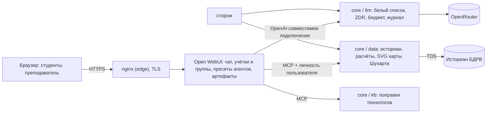

# Можно ли переделать стенд на NVIDIA NemoClaw + Open WebUI

19.10.2026 · исследование по первоисточникам (документация NVIDIA, OpenClaw, Open WebUI, GitHub, карточки моделей).
Ключевые утверждения проверены отдельным проверяющим, выводы — критиком. **[Д]** — подтверждено документом по
ссылке, **[?]** — не подтверждено. Исходные материалы исследования лежат вне репозитория; здесь — итог.

## Короткий ответ

- **Полностью на NemoClaw — нет.**
  - NemoClaw рассчитан на одного пользователя на хост. Класс из 10–11 студентов на одном сервере производитель
    прямо называет неподдерживаемым.
  - Продукт в ранней альфе без SLA.
  - Сервер заказчика без GPU. Ради главной ценности NemoClaw — локальной модели Nemotron под политиками — нужен
    GPU.
  - Регистрация в NVIDIA с российскими номерами фактически заблокирована.
- **Open WebUI как интерфейс — да.** Его можно поставить вместо нашего веб-чата поверх нашей службы данных
  (историан и расчёты), LLM-прокси и поправок базы знаний. Код ролей `data`, `llm`, `kb` переносится почти как
  есть. Оценка — около 12 дневных слайсов, при условии, что замер памяти первым днём подтвердит размещение на
  текущей ВМ.
- **NemoClaw в архитектуре возможен только в узкой роли:** один агент одного оператора (преподавателя,
  методолога или фоновые задачи). Это совпадает с моделью доверия продукта — «один оператор, один gateway». Для
  студентов он не годится. И в такой роли — с оговорками альфы, ОС и доступа к NVIDIA.

## Что это за продукты

**NVIDIA NemoClaw** — не агент, а установщик и оркестратор.

- Разворачивает песочницу **NVIDIA OpenShell**: изоляция на уровне ядра, сеть по белому списку,
  шлюз учётных данных, маршрутизация запросов к моделям.
- Внутри запускает агентный «раннер»: **OpenClaw** — личный ИИ-ассистент, MIT; также Hermes или LangChain Deep
  Agents. OpenCode, на котором работает стенд, в их число не входит [Д].
- Анонс — 16.03.2026 (GTC). Целевое железо — RTX ПК, рабочие станции, DGX Spark и DGX Station [Д].
- Статус: «alpha, early preview», «No SLA is offered» [Д].
- Проверено на Ubuntu 24.04. На сервере Ubuntu 22.04 — «may work but not validated». Офлайн-установки
  (air-gapped) не поддерживаются [Д].
- Минимум на один экземпляр — 4 vCPU / 8 ГБ ОЗУ, рекомендуется 16 ГБ [Д].
- Инференс: локальный Nemotron или облачные провайдеры, в том числе OpenRouter и любой OpenAI-совместимый.
  Режим без GPU допускается [Д].
- OpenClaw поддерживает MCP как клиент и как сервер [Д]. Значит, наши MCP-инструменты историана и базы знаний к
  нему подключаемы.

**Open WebUI** (v0.12.1, 14.10.2026) — готовый веб-интерфейс чата.

- Учётки и группы с правами на модели, инструменты и знания. Вход: локальный, OIDC, LDAP, SCIM.
- Подключение моделей по OpenAI-совместимому API.
- «Модели»-пресеты: системный промпт, инструменты, знания.
- Нативный MCP (Streamable HTTP); подключает MCP-серверы администратор.
- Знания с векторным поиском на CPU.
- Артефакты: HTML/SVG из ответа рисуются в изолированном iframe.
- Администратор может читать чаты пользователей (`ENABLE_ADMIN_CHAT_ACCESS`).
- Расход токенов по пользователям виден, но **принудительного бюджета нет** [Д].
- Лицензия Open WebUI License (с v0.6.6): убирать брендинг без корпоративной лицензии можно, если за 30 дней не
  больше 50 конечных пользователей. У стенда 11 мест [Д].

Open WebUI официально описывает подключение OpenClaw как внешнего агента через его OpenAI-совместимый эндпоинт
[Д]. Но этот эндпоинт OpenClaw документирован как «полный доступ оператора, не выставлять наружу» [Д].

## Почему полный NemoClaw для класса не подходит

| Препятствие | Что говорит первоисточник | Можно ли обойти |
|---|---|---|
| Один пользователь на хост | NemoClaw: «Sandboxes are scoped to a single host user», общий хост — Unsupported, предупреждение при установке. OpenClaw SECURITY.md: общий gateway для недоверяющих друг другу людей — не поддерживаемый режим, рекомендуется «один пользователь — одна машина — один gateway» [Д] | Только 11 отдельных машин или ВМ — по 4–16 ГБ ОЗУ каждая |
| Ресурсы | 11 × (4 vCPU / 8–16 ГБ) против 8 vCPU / 15 ГБ, которые уже делятся с Dify [Д] | Нужны новые серверы |
| Зрелость | Альфа, без SLA; стенд — в продуктиве [Д] | Ждать стабильной версии |
| Нет GPU | Локальная Nemotron требует, например, H100 80 ГБ, RTX PRO 6000 96 ГБ или DGX Spark для Nano-30B-FP8. Сжатая версия — ориентировочно от 24 ГБ видеопамяти [Д / ?] | Покупка GPU-сервера. Без него NemoClaw сводится к облачной маршрутизации, которую наш LLM-прокси уже делает (белый список, ZDR, бюджет) |
| Доступ к NVIDIA из РФ | Регистрация build.nvidia.com/NGC для номеров +7 — много тем на форуме NVIDIA без решения. Лицензия Nemotron (раздел 10) требует соблюдения экспортных правил США [Д] | Через иностранного партнёра; нужна юридическая проверка заказчика |
| ОС | Проверена Ubuntu 24.04; на сервере 22.04 [Д] | Обновить ОС ВМ — вместе с Dify |
| Раннер | OpenCode не входит в квалифицированные раннеры NemoClaw [Д] | Переписать правила агентов под OpenClaw |

## Что даёт и чего не даёт Open WebUI

| Нужно стенду | В Open WebUI |
|---|---|
| Вход и учётки, преподаватель отдельно | Штатно: роли и группы, права [Д] |
| Чат, потоковый ответ, вызовы инструментов | Штатно |
| Наши инструменты историана и базы знаний | Штатно через MCP (Streamable HTTP). Личность пользователя передаётся в заголовке или токене [Д] |
| Карта Шухарта и графики | Через артефакты: инструмент отдаёт HTML/SVG, Open WebUI рисует [Д]. Наш `calc_spc` придётся научить отдавать готовый SVG |
| «Конструктор агентов» | «Модели»-пресеты собираются формой. Диалоговая сборка, как сейчас, — своей функцией [?] |
| Чтение разговоров студентов преподавателем | Штатно (`ENABLE_ADMIN_CHAT_ACCESS`) [Д] |
| Бюджет и доли мест | **Нет принуждения** — только наблюдение. Оставляем наш LLM-прокси: он уже принуждает [Д] |
| Изоляция «контейнер на студента» | **Нет.** Инструменты и функции Open WebUI исполняются в его процессе. Изолированное исполнение кода по пользователю (Terminals) — по корпоративной лицензии [Д] |
| Калькуляторы без модели, события агентов, уроки | Готового нет — отдельная страница рядом или свои функции |
| Безопасность | За 2025–2026 в инструментах, функциях и исполнении кода — ряд RCE CVE. Руководство по защите для «класса» велит не давать пользователям создавать инструменты и выключать исполнение кода [Д] |

## Варианты

### A. Open WebUI + наш `core` — рекомендуется

**Что меняется:**
- Наш React-чат и места OpenCode заменяет Open WebUI. Роли `data`, `llm`, `kb` остаются; меняется, кто их
  вызывает.
- Мест — контейнеров на студента — больше нет. Нет сна и пробуждения, нет перезагрузки мест.

**Переиспользуем:** службу данных целиком — историан, белый список, ворота, все расчёты; LLM-прокси — белый
список, ZDR, запасная модель, бюджет, журнал; поправки базы знаний; сторож; nginx.

**Пишем:**
1. **Идентификация вызывающего.** Сейчас это токен места **плюс сетевая привязка** (место 03 не может
   представиться местом 07). В Open WebUI личность — заголовок или токен сессии одного процесса, второго
   (сетевого) слоя нет. Схему `caller` нужно пересобрать по всем потребителям: пределы частоты, доли бюджета,
   журнал событий, агенты. Это отдельный слайс, не правка в двух местах.
2. SVG карты Шухарта в ответе `calc_spc`.
3. Пресеты «Помощник» и «Конструктор»; диалоговая сборка агента студентом — своей функцией.
4. Калькуляторы, события, уроки — лёгкая страница рядом или функции Open WebUI.
5. База знаний V1/V2. Штатные «знания» Open WebUI ищут по кускам. Чтобы сохранить нынешнее «индекс → выбрать
   файл → прочитать целиком», нужен свой инструмент.
6. Сторож. Проверки `gateway` (уборщик мест), `agents` (перезагрузка мест) и часть `teacher` (доли по местам)
   завязаны на места — их переписать. Плюс новая проверка здоровья Open WebUI.
7. Аналитика КДМ-1 (роль `analytics`, сейчас выключена). Либо оставить без интерфейса, либо мост к её ручкам —
   решение заказчика.

**Безопасность.** Модель угроз стенда (`docs/reference/20-security.md`): опасен не студент, а то, что исполняется
от его имени — модель, инструмент, обработанный текст. Если исполнение кода и пользовательские инструменты в
Open WebUI выключены, у модели остаются только зарегистрированные администратором MCP-инструменты. Это те же
каналы, что сейчас. Потеря gVisor-изоляции тогда не открывает новых путей. Взамен появляется общий процесс
Open WebUI с историей RCE в функциях: обязательны руководство по защите, ограничение прав
(`DEFAULT_USER_ROLE=pending`, без «Tools Access» у студентов) и своевременные обновления.

**Ресурсы.**
- Добавляются Open WebUI, PostgreSQL и Redis — так документация советует для нескольких пользователей.
- Исчезают 11 контейнеров мест по 1 ГБ (большую часть времени они спят).
- Официальных цифр потребления у Open WebUI нет. Влезает ли всё на 8 vCPU / 15 ГБ рядом с Dify — показывает
  только замер. Это первый слайс.

**План по дням** (каждый день — видимый результат; оценка действительна после слайса 1):

1. Замер: Open WebUI + PostgreSQL + Redis рядом с Dify под нагрузкой 11 сессий. Если не влезает — решение о
   ресурсах до продолжения.
2. Open WebUI подключён к нашему `/llm/v1`: чат отвечает, бюджет действует.
3. MCP службы данных и базы знаний зарегистрированы, вызов инструментов из чата.
4. Учётки и группы: студенты, преподаватели; права без «Tools Access»; чтение чатов преподавателем.
5. Новая схема вызывающего (часть 1): личность пользователя до `data`/`kb`/`llm`.
6. Новая схема вызывающего (часть 2): доли бюджета и пределы по пользователю, журналы.
7. Пресеты «Помощник» и «Конструктор» с текущими правилами.
8. Диалоговая сборка агента студентом.
9. SVG карты Шухарта в артефактах.
10. Калькуляторы, события, уроки — страница рядом.
11. Сторож: переписанные проверки и проверка Open WebUI; nginx.
12. Защита по чек-листу Open WebUI; приёмка под учёткой-образцом.

Итого около 12 дней. Не входит: перенос базы знаний на «индекс → файл» своим инструментом (если нужен) и
аналитика.

**Что теряем:** контейнер на студента (см. «Безопасность»), собственный интерфейс чата (будет интерфейс Open
WebUI под своим брендом), калькуляторы и события как вкладки чата.

### B. NemoClaw/OpenClaw на каждого студента + Open WebUI — невозможно на текущем сервере

Нужны 11 отдельных машин или ВМ (по рекомендации производителя), GPU для локальной модели, доступ к NVIDIA.
Продукт в альфе и не поддерживает общий хост. Переписать правила агентов под OpenClaw. История разговоров
хранится у OpenClaw (`~/.openclaw/agents/<agentId>/sessions/*.jsonl`), а не в Open WebUI — кабинет преподавателя
придётся переделывать [Д].

### C. Вариант A + NemoClaw для одного агента оператора — возможен как пилот, с оговорками

NemoClaw (OpenShell + OpenClaw) для одного «хозяина» — преподавателя, методолога или фоновых задач, например
ночного разбора событий. Это совпадает с моделью доверия продукта. Подключение к нашим MCP и к OpenRouter
документировано [Д]. Оговорки:
- альфа без SLA;
- Ubuntu 22.04 не проверена;
- без GPU — только облачный инференс;
- нужен ли аккаунт NVIDIA для установки без NIM — [?], проверить пилотом.

Студентам вариант C ничего не меняет. Имеет смысл, если заказчику важно «NemoClaw в архитектуре» или нужен
автономный агент оператора.

## Риски варианта A

- **Влезет ли в ВМ рядом с Dify** — неизвестно до замера. Возможно, понадобится вынести Dify или добавить памяти.
- **Безопасность общего процесса Open WebUI.** История RCE CVE; строгие права и обновления обязательны.
- **Бюджет и доли** держит только наш LLM-прокси. Если когда-нибудь подключить модели к Open WebUI в обход
  прокси, контроль бюджета пропадёт.
- **Поведение агентов.** Правила моделей придётся перенести в пресеты Open WebUI. Ответы могут отличаться от
  нынешних — нужна приёмка на тех же вопросах.
- **Обновления Open WebUI** выходят часто, поведение функций меняется. Закрепить версию и обновлять осознанно.

## Вопросы заказчику — без них решение не принять

1. Что заказчик понимает под «работой агентов через NemoClaw»?
   - Песочница для свободного исполнения кода студентом — тогда нужна изоляция на пользователя, и вариант A без
     платного Terminals её не даёт.
   - Или тот же набор фиксированных инструментов, что сейчас — тогда достаточно варианта A.
2. Нужна ли формально изоляция «контейнер на студента» (аудит, требования безопасности заказчика), если студент
   не исполняет свой код?
3. Есть ли планы на GPU-сервер и локальные модели? Если да — какой бюджет и сроки: это меняет роль NemoClaw.
4. Может ли заказчик получить доступ к NVIDIA (аккаунт NGC/build.nvidia.com) через иностранное юрлицо или
   партнёра? Проведёт ли юридическую проверку экспортного раздела лицензии Nemotron?
5. Готов ли заказчик обновить ОС ВМ до Ubuntu 24.04 (вместе с Dify) или выделить отдельную ВМ?
6. Устраивает ли переход с нашего интерфейса чата на интерфейс Open WebUI под брендом ПЦБК?
7. База знаний V1/V2 — сохранить «агент читает индекс и выбирает документ целиком» или перейти на штатный
   векторный поиск Open WebUI?
8. Можно ли добавить ресурсы ВМ или вынести Dify, если замер покажет нехватку памяти?
9. Аналитика КДМ-1 (сейчас выключена) — нужна ли в новом интерфейсе?

## Источники (основные)

- NemoClaw: [платформы и ограничения](https://docs.nvidia.com/nemoclaw/user-guide/openclaw/reference/platform-support) ·
  [требования](https://docs.nvidia.com/nemoclaw/user-guide/openclaw/get-started/prerequisites) ·
  [варианты инференса](https://docs.nvidia.com/nemoclaw/inference/inference-options) ·
  [безопасность](https://docs.nvidia.com/nemoclaw/user-guide/openclaw/security/best-practices) ·
  [GitHub](https://github.com/NVIDIA/NemoClaw) · [анонс](https://nvidianews.nvidia.com/news/nvidia-announces-nemoclaw)
- OpenShell: [архитектура](https://docs.nvidia.com/openshell/about/architecture) ·
  [GitHub](https://github.com/NVIDIA/OpenShell)
- OpenClaw: [SECURITY.md](https://github.com/openclaw/openclaw/blob/main/SECURITY.md) ·
  [OpenAI-совместимый эндпоинт](https://docs.openclaw.ai/gateway/openai-http-api) ·
  [лицензия](https://github.com/openclaw/openclaw/blob/main/LICENSE)
- Open WebUI: [MCP](https://docs.openwebui.com/features/extensibility/mcp/) ·
  [права и роли](https://docs.openwebui.com/features/authentication-access/rbac/) ·
  [модели-пресеты](https://docs.openwebui.com/features/workspace/models/) ·
  [подключение агента](https://docs.openwebui.com/getting-started/quick-start/connect-an-agent/) ·
  [аналитика](https://docs.openwebui.com/features/administration/analytics/) ·
  [защита](https://docs.openwebui.com/getting-started/advanced-topics/hardening/) ·
  [многопользовательский Open Terminal](https://docs.openwebui.com/features/open-terminal/advanced/multi-user/) ·
  [артефакты](https://docs.openwebui.com/features/chat-conversations/chat-features/code-execution/artifacts/) ·
  [лицензия](https://github.com/open-webui/open-webui/blob/main/LICENSE)
- Nemotron: [карточка Nano-30B-A3B-FP8](https://huggingface.co/nvidia/NVIDIA-Nemotron-3-Nano-30B-A3B-FP8) ·
  [NVIDIA Open Model Agreement](https://www.nvidia.com/en-us/agreements/enterprise-software/nvidia-open-model-agreement/)
