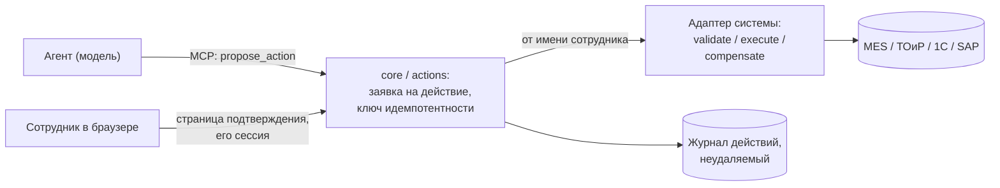

# Целевая архитектура продуктива для предприятия: план и сроки

19.10.2026. Рамка сменилась: это уже не учебный стенд на 11 мест, а продуктив для сотрудников ПЦБК.

**Исходные решения владельца:**
- пользователей до 50 в месяц;
- модели — облако РФ (Yandex AI Studio, Cloud.ru);
- агенты не только читают и анализируют, но и **действуют в системах предприятия**: заявки, записи в MES/ТОиР;
- интерфейс — «классический чат как Claude Desktop, с проектами и чатами»: на обучении он дал наибольший прирост.

Исследование — по первоисточникам, ключевые факты сверены критиком. **[Д]** — подтверждено по ссылке, **[?]** —
не подтверждено. Предыдущие документы: [12](12-nemoclaw-open-webui-2026-10-19.md),
[13](13-alternatives-to-nemoclaw-open-webui-2026-10-19.md).

## Коротко

1. **Основа — наш `core`.**
   - Служба данных к историану: белый список тегов, ворота, расчёты, карта Шухарта с графиком.
   - LLM-прокси: белый список моделей, бюджет, запасная модель, журнал.
   - Поправки базы знаний.
   Эти роли уже не привязаны к «месту» студента: вызывающий для них — просто строка. Переход на личность
   сотрудника не требует переписывать бюджет и журналы [Д, код].
2. **Новое в `core` — роль `actions`** для действий агентов в системах предприятия, по образцу уже работающих
   согласований (`analytics/reviews.py`):
   - агент только **предлагает** действие;
   - **подтверждает сотрудник** на отдельной странице под своей сессией — у модели физически нет к ней доступа;
   - исполнитель выполняет действие **от имени сотрудника**;
   - всё пишется в неудаляемый журнал.
3. **Интерфейс «проекты и чаты»** — два реальных пути:
   - **А. Наш чат + проекты** (рекомендую). Проекты — инструкции, файлы и чаты внутри. Графики историана и
     бюджет на сотрудника уже работают. Проекты можно попробовать сделать на штатных каталогах-проектах OpenCode
     — гипотеза, проверка за день.
   - **Б. LibreChat.** Проекты и подтверждение вызова инструмента — штатные [Д], лицензия MIT, вход через
     LDAP/OIDC. Ценой переноса графиков и потери изоляции агента на пользователя.
   - Open WebUI — запасной вариант: проекты есть, подтверждение — только через MCP elicitation в WebSocket-сессии.
4. **Модели** — две площадки РФ: Cloud.ru и Yandex AI Studio. Основная и запасная, через наш прокси. До выбора
   надо проверить три вещи:
   - вызов инструментов вживую;
   - корпоративные лимиты;
   - письменные условия о данных.
5. **Продуктив — на отдельной ВМ**, не рядом с Dify и учебным стендом.
6. **Срок до пилота с чтением и анализом — 3–4 недели. С действиями в системах — ещё 2–3 недели. Выход на 50
   сотрудников — ещё 1–2 недели.** Подробно — в разделе «План и сроки».

## Интерфейс: «как Claude Desktop с проектами и чатами»

Эталон — проект в Claude: свои инструкции, файлы и знания проекта, чаты внутри, артефакты; подтверждение вызова
инструмента «разрешить один раз / всегда» [Д: anthropic.com/news/projects, support.claude.com].

| Вариант | Проекты | Подтверждение действия в интерфейсе | Личность сотрудника в наших инструментах | Графики историана | Довести, дней |
|---|---|---|---|---|---|
| **Наш чат** | нет; добавить: инструкции + файлы + чаты | у OpenCode в протоколе есть запрос разрешения (`permission.asked`/`replied`); в интерфейсе сейчас только «Отклонить» [Д, код]; действия — через нашу страницу подтверждения | есть | **есть** (карта Шухарта из данных) | 7–11 (проекты, MVP) |
| **LibreChat** | **есть**, с v0.8.7: инструкции на проект, до 50 файлов через поиск по файлам [Д] | **есть**: администратор может требовать проверки вызова инструмента — одобрить, отклонить, поправить аргументы [Д]; в какой стабильный выпуск это вошло — [?] | есть (`{{LIBRECHAT_USER_ID}}`, проброс OAuth) [Д] | нет — через артефакты модели или ссылку на панель | 12–18 |
| **Open WebUI** | **есть**, «Folders & Projects»: системный промпт и знания на папку [Д] | MCP elicitation влита (PR #27158, 10.10.2026), только для WebSocket-сессий [Д]; кнопки «разрешить вызов» в бесплатной редакции нет [?] | есть | через артефакты | 15–22 |
| AnythingLLM | рабочие области ≈ проекты | — | **нет**: заголовки MCP статичные [Д] | — | не рекомендую |

**Почему рекомендую А.**
- Самое дорогое — графики историана, бюджет на сотрудника, связка с нашими инструментами — уже готово.
- Не хватает только сущности «проект». Её дешевле дописать, чем переносить остальное на чужой стек.
- Агент сотрудника продолжает работать в своём контейнере OpenCode. Файлы проекта он читает штатными
  инструментами чтения и поиска, без векторной базы.

**Когда выбрать Б.** Если заказчику важнее готовый интерфейс «из коробки», чем наши графики в чате. Графики
тогда — отдельной панелью (Grafana или страница графика) со ссылкой из ответа.

## Действия агентов в системах предприятия

**Схема — «предложить → подтвердить → исполнить → журнал».**

- **Модель не может подтвердить сама себя.** Подтверждение — отдельный HTTP-маршрут шлюза с сессией сотрудника
  (cookie, проверка источника запроса), а не MCP-инструмент и не поле в вызове модели. Так уже сделано в
  согласованиях: личность решающего — только из серверной сессии, поля «кто решил» в теле запроса запрещены
  моделью данных (`gateway/analytics_api.py`) [Д, код].
- **Нынешний приём `save_agent` (модель цитирует согласие пользователя) для действий не годится.** Модель может
  подставить текст, которого человек не говорил.
- **Что видит сотрудник при подтверждении.**
  - Не пересказ модели, а **сами поля**, которые уйдут в систему: тип действия, объект, значения.
  - Рядом — откуда агент это взял.
  - Текст, пришедший из данных, показывается как данные, а не как инструкция. Это защита от внедрения команд
    в текст черновика и от подтверждения «не глядя».
- **Права и журнал.**
  - Права на виды действий — по ролям; срочные и отзываемые полномочия.
  - Автор не подтверждает свою же заявку там, где нужен второй человек.
  - Журнал решений не урезается.
  Всё это уже есть в согласованиях аналитики — переносим [Д, код].
- **Идемпотентность** — уникальный ключ заявки, повтор не создаёт второе действие. Приём уже есть в хранилище
  аналитики [Д, код].
- **Личность сотрудника в целевой системе.** Два варианта:
  - обмен токена OAuth 2.0 (RFC 8693), если система его поддерживает;
  - сервисная учётка плюс подписанное «от имени» — для старых систем.
  Выбор — когда заказчик назовёт систему.
- **MCP elicitation** (запрос подтверждения в протоколе MCP) — только как будущее удобство поверх нашей
  страницы, не как основа первого выпуска: поддержка в интерфейсах частичная [Д].

**Сроки:**
- ядро `actions` — 7–10 дней;
- один адаптер к системе с готовым REST/OData и тестовой средой — 3–5 дней; без современного API — 8–15 дней.

## Модели в облаке РФ

| | Cloud.ru Foundation Models | Yandex AI Studio |
|---|---|---|
| API | OpenAI-совместимый [Д] | OpenAI-совместимый [Д] |
| Модели с вызовом инструментов | DeepSeek-V4-Flash, DeepSeek-V4-Pro, GLM-5.1, Qwen3, GigaChat и др. (тег function calling в каталоге) [Д]. **DeepSeek-V4.1-Flash в каталоге нет** — есть V4-Flash [Д] | DeepSeek-V4.1-Flash, Qwen3, gpt-oss, YandexGPT [Д]. Вызов инструментов при потоковом ответе — проверить вживую [?] |
| Данные | «не используется для обучения» — не найдено, только PDF-договор [?] | **по умолчанию сохраняет все запросы**; заголовок `x-data-logging-enabled: false` отключает это, и содержимое не используется для улучшения сервиса [Д]. Соответствие 152-ФЗ — получить письменно [?] |
| Лимиты | в открытой документации не найдены [?] | без подписки — **2 одновременных генерации** [Д?]; корпоративный тариф уточнить |

**Предварительный выбор** (до прогона):
- основная — GLM-5.1 или DeepSeek-V4-Flash на Cloud.ru;
- запасная — DeepSeek-V4.1-Flash на Yandex;
- решение — после прогона `bench` на 2–3 моделях.

**Что меняется в LLM-прокси.** Сейчас он построен вокруг одного OpenRouter с его особыми полями (`provider`,
`zdr`, `max_price`, ручки `/key`, `/generation`). Нужны:
- несколько провайдеров с принадлежностью модели провайдеру в `ModelPolicy`;
- заголовок отключения журналирования;
- учёт цены по таблице, если провайдер её не возвращает.

**Срок** — 4–6 дней, если формат вызова инструментов совместим. План Б — один провайдер без запасного, пока
второй не пройдёт проверку.

## Готовность `core` к продуктиву

| Блок | Сейчас | Нужно | Дней |
|---|---|---|---|
| Вход сотрудников | только локальные учётки (scrypt) [Д, код] | LDAP/AD или OIDC | 3–4 |
| Личность сотрудника в инструментах и прокси | токен места + сеть места | токен сотрудника от шлюза; вызывающий = сотрудник | 2–3 |
| Доступ к данным по ролям и подразделениям | белый список тегов общий | фильтр тегов и знаний по роли; разметка тегов — заказчиком. Файлы роли `data` — защищённые: нужно решение владельца | 3–5 |
| Бюджет | доли мест | по сотруднику или подразделению — новый ключ той же таблицы | 1–2 |
| Устойчивость по ревью | см. [ревью](../review/CODE-REVIEW-2026-10-18.md) | пакеты П1 (запись в базу при блокировке), П2 (сеть до модели), П3 (уведомления, доля сбоев модели, диск) | 5–7 |
| Эксплуатация | копия базы вручную на том же диске; нет уведомлений | ежедневная копия вне сервера, уведомления о падении и молчании, ротация журналов (П5) | 2–3 |
| Места OpenCode на 50 сотрудников (только путь А) | 11 мест зашиты в код и compose; потолок памяти ~11,75 ГиБ | места по требованию (выделение при входе, сон по простою), отдельная ВМ; нагрузочный тест | 5–10 |
| ИБ заказчика | модель угроз учебного стенда | модель угроз продуктива, схема потоков данных (облако РФ), журналы, порядок обновлений | 2–3 |

**Ёмкость.** На текущей ВМ рядом с Dify 10 одновременных мест уже проходили нагрузку: свободной памяти оставалось
около 7 ГБ при 10 местах (12.10). Для продуктива — 50 сотрудников, 10–15 одновременно — нужна отдельная ВМ. Для
пути А ориентир 8–16 vCPU и 32 ГБ; точнее — по нагрузочному тесту.

## План и сроки

Каждый день — видимый результат. Сроки в рабочих днях, путь А. Для пути Б — отдельной строкой ниже.

**Фаза 1. Пилот «чтение и анализ» — 15–20 дней.** 5–10 сотрудников, без действий в системах.
- Вход через корпоративную учётку, личность сотрудника в инструментах и прокси — 5–7.
- Модели РФ: два провайдера, прогон `bench`, выбор — 4–6.
- Проекты в чате (MVP: инструкции + файлы + чаты) — 7–11; первый день — проверка гипотезы «проекты на каталогах
  OpenCode».
- Устойчивость и эксплуатация (П1–П3, П5) — 7–10, частично параллельно с остальным.
- Отдельная ВМ и перенос — 2.

**Фаза 2. Действия в системах — 10–15 дней.** Начинается, когда заказчик назовёт первую систему и даст тестовую
среду.
- Ядро `actions`: заявка, страница подтверждения с полями, журнал, права — 7–10.
- Первый адаптер — 3–5 (REST/OData) или 8–15 (без API).
- Пилот: один вид действия, одно подразделение.

**Фаза 3. Выход на 50 сотрудников — 5–10 дней.**
- Доступ к данным по ролям — после разметки тегов заказчиком.
- Бюджет по подразделениям.
- Места по требованию, нагрузочный тест на 15 одновременных пользователей.
- Документы для ИБ.

| Путь | Фаза 1 | Фаза 2 | Фаза 3 | Итого |
|---|---|---|---|---|
| **А. Наш чат + проекты** | 15–20 | 10–15 (+адаптер) | 5–10 | **30–45 дней** |
| Б. LibreChat + наш `core` | 15–22 (интерфейс 12–18 вместо проектов; места не нужны) | 10–15 | 3–6 | 28–43 дня |
| Open WebUI + наш `core` | 18–25 | 12–18 (подтверждение — своя страница) | 3–6 | 33–49 дней |

**Календарь при старте 21.10 по пути А:**
- пилот «чтение и анализ» — **10–17.11**;
- действия в системах — **01–08.12**, если система и тестовая среда будут названы к середине ноября;
- 50 сотрудников — **15–22.12**.

**Критерии пилота.**
- **Успех:** сотрудники ведут работу в проектах; ответы с данными историана верны при выборочной сверке; ни
  одного действия без подтверждения; сбои модели — меньше 5 % вызовов.
- **Неуспех:** неверные числа, действие без подтверждения или не от того сотрудника, недоступность больше
  часа без уведомления.

**Что сдвинет сроки** (не зависит от разработки):
- договоры и лимиты у провайдеров РФ;
- выбор системы для действий и её тестовая среда;
- разметка тегов по подразделениям;
- согласование с ИБ;
- выделение ВМ.

## Решения и вопросы

Нужно от владельца или заказчика:
1. Интерфейс: **А** (наш чат + проекты) или **Б** (LibreChat)?
2. Какая система первой для действий (1С:ТОиР, SAP PM, MES …), есть ли у неё API и тестовая среда?
3. Вход: Active Directory (LDAP) или OIDC (например, Keycloak)?
4. Провайдер моделей: договор с Cloud.ru и/или Yandex.
   - корпоративные лимиты: у Yandex без подписки — 2 одновременных генерации;
   - письменно — условия по данным (152-ФЗ, неиспользование для обучения).
5. Отдельная ВМ под продуктив: можно ли выделить 8–16 vCPU / 32 ГБ?
6. Подразделения и роли для доступа к данным: кто размечает теги?
7. Учебный стенд остаётся рядом как есть?

## Источники (основные)

- Claude Projects: [анонс](https://www.anthropic.com/news/projects)
- LibreChat: [проекты](https://www.librechat.ai/docs/features/projects),
  [агенты и проверка вызовов инструментов](https://www.librechat.ai/docs/features/agents),
  [MCP](https://www.librechat.ai/docs/features/mcp)
- Open WebUI: [папки и проекты](https://docs.openwebui.com/features/chat-conversations/conversation-organization/),
  [MCP](https://docs.openwebui.com/features/extensibility/mcp/),
  [PR #27158 (elicitation)](https://github.com/open-webui/open-webui/pull/27158)
- AnythingLLM: [MCP](https://docs.anythingllm.com/mcp-compatibility/overview)
- MCP: [elicitation](https://modelcontextprotocol.io/specification/2025-06-18/client/elicitation)
- OAuth 2.0 Token Exchange: [RFC 8693](https://www.rfc-editor.org/rfc/rfc8693)
- Yandex AI Studio: [отключение журналирования](https://aistudio.yandex.ru/docs/ru/ai-studio/operations/disable-logging) ·
  Cloud.ru: [каталог моделей](https://cloud.ru/docs/foundation-models/ug/topics/overview__available__models)
- Код стенда: `core/pcbk_core/analytics/reviews.py`, `core/pcbk_core/gateway/analytics_api.py`,
  `core/pcbk_core/analytics/store.py`, `web/src/components/PendingInteractions.tsx`
